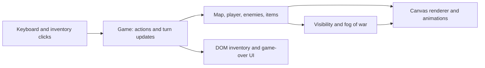

# Tower Crawler

## What it does

A browser dungeon crawler with procedurally generated rooms, turn-based combat, enemies, collectible items, and fog of war. It is a TypeScript game prototype built directly on the browser canvas, with a separate animation loop for visual feedback.

## Architecture

**Stack:** TypeScript, HTML Canvas, DOM UI, and Vite. There is no backend or game engine dependency.



- `main.ts` starts the game using `src/configs/settings.ts`.
- `Game` coordinates initialization, input, player actions, enemy updates, UI updates, and restart.
- `GameMap` places nonoverlapping random rooms and joins successive rooms with corridors.
- `Visibility` casts Bresenham lines around the player to track hidden, revealed, and currently visible tiles.
- `Player`, `EnemyManager`, and `ItemManager` own combat and item behavior. Dash and cleave are separate ability classes.
- `Renderer` draws the world on a `requestAnimationFrame` loop, including movement, hit flashes, damage numbers, and screen shake.

## Engineering challenges

- **Turn state versus animation time:** the game waits for an input action before updating the world, while rendering runs continuously. This allows movement and damage effects to play between turns.
- **Procedural generation:** rooms must avoid overlap while corridors connect the generated layout. A floor-tile list provides spawn candidates.
- **Visibility:** line tracing stops at walls and respects the player's circular view radius; previously explored tiles retain a revealed state.
- **Composing combat feedback:** entity events trigger animation objects, keeping much of the visual behavior outside combat calculations.
- **Lifecycle management:** restart recreates the world and input flow. Repeated death/restart cycles are an important area for listener and animation cleanup testing.

## How to run it

Prerequisites: Node.js 22.12+ and npm.

```bash
git clone https://github.com/aleksanderantropov/tower-crawler.git
cd tower-crawler
npm ci
npm run dev
```

Open the URL printed by Vite, normally `http://localhost:5173`. No environment variables or external services are required.

```bash
npm run typecheck
```

The repository currently provides development and type-check commands; it does not define a production build script.

### Local walkthrough

| Control | Action |
| --- | --- |
| Arrow keys | Move; moving into an enemy attacks it. |
| Space | Wait for a turn. |
| `q` | Use dash, subject to cooldown. |
| `e` | Use cleave, subject to cooldown. |
| Number keys starting at `1` | Use an inventory item. |
| Click an inventory entry | Use that item. |

Explore to reveal the map, fight enemies, collect drops by stepping onto them, and use the game-over UI to restart.

## Current limitations

- The current experience is a single generated dungeon; tower progression and saved runs are not implemented.
- The existing roadmap calls for a minimap, clearer view-direction controls, manual item pickup, dropping items, an inventory limit, and richer ability animations.
- Movement animations already exist, although the original roadmap still lists movement animation as future work.
- There is no automated test suite. Useful next steps include seeded generation tests, collision and visibility edge cases, ability cooldown tests, and repeated restart checks.
- Input is primarily keyboard based; touch controls and accessibility improvements remain future work.
